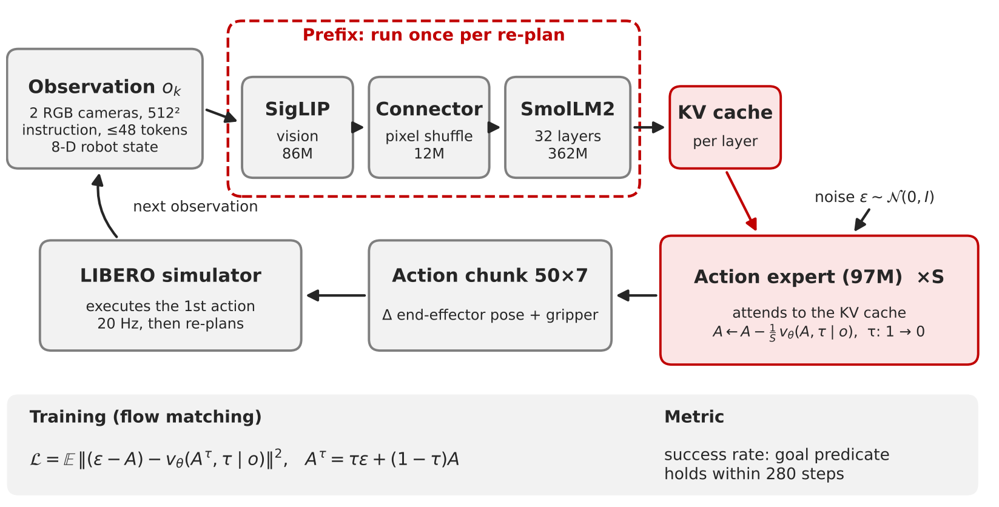

# Cheaper Re-planning, not Less Re-planning: An Efficiency Study of SmolVLA on a Turing GPU

**[Report (PDF, 4 pages)](paper/main.pdf)** · **[Literature matrix (xlsx)](deliverables/literature_matrix.xlsx)** ·
[Kaggle notebook](notebooks/kaggle_efficient_vla.ipynb)

Inference-time efficiency study of [SmolVLA](https://arxiv.org/abs/2506.01844) (checkpoint
`HuggingFaceVLA/smolvla_libero`, LeRobot v0.6.1) on LIBERO-Spatial with a Tesla T4. The question: which ways
of making a re-plan cheaper keep closed-loop success, tested on identical episodes with paired statistics.
No training: weights and protocol stay fixed, only the execution changes.



## Results

The released checkpoint succeeds in **77.0%** of 200 LIBERO-Spatial episodes, and one re-plan takes **789 ms** on
a T4, dominated by emulated bfloat16 and a launch-bound 10-step flow loop.

| Variant | Re-plan (ms) | Initial states (pairs) | Released SR | Variant SR | ΔSR [95% CI] |
|---|---|---|---|---|---|
| Open loop, 5 actions per chunk | – | 0–19 (200) | 77.0 | 64.5 | −12.5 [−20.3, −4.5] |
| Stale image (cached up to 5 steps), S = 3 | – | 0–19 (200) | 77.0 | 65.0 | −12.0 [−19.1, −4.7] |
| fp16, 3 Euler steps (+ CUDA graph for latency) | 112 | 0–49 (500) | 75.4 | 78.4 | +3.0 [−0.6, +6.6] |
| fp16, 1 Euler step (+ CUDA graph), confirmation | 93 | 20–49 (300) | 74.3 | 80.3 | +6.0 [+0.6, +11.4] |
| fp16, 3 steps, one fixed noise per episode (probe) | – | 0–19 (200) | 77.0 | 23.5 | −53.5 [−60.3, −45.4] |

Re-planning less often lowers success; re-planning more cheaply keeps it (non-inferior: the lower bound clears
−5 points). The latency levers are known from earlier work; what this study adds is why they work on a T4 and
the paired closed-loop evidence. Success rates come from eager runs; the CUDA graph returns the same actions on
isolated calls, and in the loop graph and eager agree on the outcome of all 20 checked episodes. States 20–49
were added to the fp16 S = 3 test after the 200-pair interim look; the S = 1 test on them was fixed before the run.
All numbers: `PYTHONPATH=src python scripts/report_numbers.py` (writes `results/t4/report_numbers.json`).

## Layout

| Path | Content |
|---|---|
| `paper/` | LaTeX report (`main.tex`, sections in `sec/`, figure script `scripts/make_pipeline_figure.py`) |
| `deliverables/` | Literature matrix (`literature_matrix.xlsx`), built by `scripts/build_literature_matrix.py` from `data/` |
| `src/evla/run_eval.py` | Resumable per-episode evaluation (one CSV row per episode) |
| `src/evla/methods.py` | Inference variants, common random numbers, CUDA-graph replay, timing |
| `src/evla/loading.py` | Builds policy, processors and LIBERO envs as `lerobot-eval` does |
| `src/evla/profile.py`, `bench_graph.py` | Cost of one re-plan by component; latency over precision × Euler steps × eager/graph |
| `src/evla/noise_spread.py` | How much the executed action depends on the flow noise for S = 1, 3, 10 |
| `src/evla/calibrate_warm.py` | Offline calibration of warm-started flow (rejected before closed-loop runs) |
| `src/evla/stats.py`, `analyze.py` | Paired statistics (exact McNemar, Newcombe CI, task-cluster bootstrap, Holm); summary tables |
| `scripts/report_numbers.py` | Every number quoted in the report, recomputed from the raw results |
| `scripts/kaggle_setup.sh`, `run_queue.sh`, `launch_eval.sh`, `bg.sh` | Pinned setup; queued, sharded, detached runs on two T4s |
| `scripts/queues/` | The run queues in the order they ran, with a map to the report ([README](scripts/queues/README.md)) |
| `results/t4/` | `raw/` episode CSVs, executed actions, a few videos; `latency/`, `profile/`, `probe/`; `logs/` |
| `notebooks/kaggle_efficient_vla.ipynb` | Clean copy of the Kaggle notebook |
| `tests/test_offline.py` | CPU tests (`python -m pytest -q tests`) |
| `docs/report_appendix.tex` | Material cut from the 4-page report (reproducibility, per-task results, failure modes, warm start) |

## Environment

Kaggle notebook, accelerator "GPU T4 x2", Internet on.
`scripts/kaggle_setup.sh` installs, with versions pinned on purpose:

| Package | Version | Why pinned |
|---|---|---|
| lerobot (`[smolvla,libero]`) | 0.6.1 (git tag) | Checkpoint and processors match this release |
| mujoco | 3.3.7 (< 3.4) | From 3.4 the stored init states of task 5 settle differently (lerobot #4390) |
| torch | 2.11.0 + CUDA 12.8 | Kaggle image |
| transformers | 5.5.4 | Pulled by lerobot |
| hf-libero / robosuite | 0.1.4 / 1.4.0 | Pulled by lerobot |

The script also registers the NVIDIA EGL vendor library (otherwise MuJoCo renders in software)
and answers LIBERO's first-import prompt. Python 3.13.

## Reproducing

```bash
git clone https://github.com/Ngoc-LM/efficient-vla && cd efficient-vla
bash scripts/kaggle_setup.sh

# 1) component profile and the latency table (isolated calls, batch 1)
PYTHONPATH=src python -m evla.profile --out results/t4/profile/profile_t4.json
PYTHONPATH=src python -m evla.bench_graph --out results/t4/profile/graph_t4.json

# 2) closed-loop runs: each queue line is "<name> <run_eval options>"
bash scripts/bg.sh /kaggle/working/results/queue.log bash scripts/run_queue.sh scripts/queues/queue_spatial_v6.txt
python scripts/monitor.py /kaggle/working/results/raw

# 3) paired analysis and every number in the report (CPU is enough)
PYTHONPATH=src python -m evla.analyze --root results/t4/raw --out results/t4/summary.json
PYTHONPATH=src python scripts/report_numbers.py
```

Episodes are keyed by `e = 1000*task + init`; the environment seed is `1000 + e` and the flow
noise of the re-plan at step `k` is drawn with seed `10000*e + k` for every method (common random
numbers), so two methods see the same initial state and the same noise. Interrupted runs resume:
finished episodes in the CSV (or in `--skip-from`) are skipped.

### Variants

| Variant | `run_eval` options |
|---|---|
| Released | `--method baseline` |
| Open loop | `--method open_loop --k 5` (or 10) |
| Gripper events | `... --event-trigger --hold 5` |
| Stale image | `--method stale --k 5 --flow-steps 3` |
| Fewer Euler steps | `--method flow --flow-steps 3` (2, 1) |
| Float16 | `... --dtype fp16` |
| CUDA graph | `... --graph` |
| Fixed noise | `... --fixed-noise` |

Warm-starting the flow from the previous chunk was calibrated offline
(`python -m evla.calibrate_warm --out results/calib.json`) and was no more accurate than a cold start with the same
number of steps, so it was not run in closed loop.

## Statistics

Success-rate differences are paired over identical episodes: exact McNemar test, Newcombe 95%
CI for the paired difference, task-cluster bootstrap CI, and Holm adjustment over the
nine comparisons with the released policy on initial states 0–19 (the tests on states 20–49 are unadjusted).
A variant is non-inferior when the lower CI bound exceeds −5 points, a margin fixed before any run.

## License and attribution

Code in this repository: [MIT](LICENSE). SmolVLA, LeRobot and LIBERO belong to their authors and keep their own
licenses; this repository only wraps them for evaluation.
